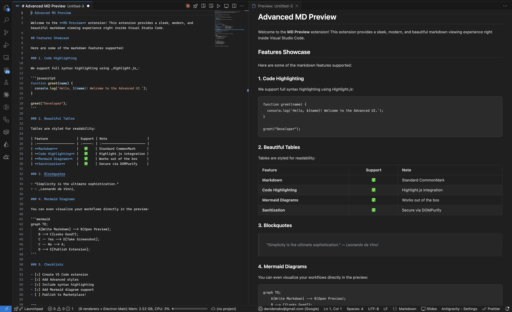

# MD Preview

An Advanced-styled Markdown preview and creation extension for Visual Studio Code.

## Features

- **Real-time Preview**: See your markdown rendered beautifully as you type.
- **Advanced Styling**: A modern, clean, and elegant design for your documents.
- **Quick File Creation**: Quickly create new markdown files with a predefined frontmatter template.
- **Mermaid Support**: Render flowcharts, diagrams, and more directly in your preview.
- **Code Highlighting**: Syntax highlighting for your code snippets.

## Usage

1. **Open Preview**: Open any `.md` file, and click the rocket icon `$(rocket)` in the top right corner of the editor, or run the command `MD Preview: Show Preview` from the command palette.
2. **Create New File**: Run the command `MD Preview: Create File` to create a new markdown file with default frontmatter.

## Screenshots

_(Insert screenshots of the extension in action here)_
Example:


## Credits & References

This extension makes use of several amazing open-source libraries:

- [Marked](https://marked.js.org/) for Markdown parsing.
- [DOMPurify](https://github.com/cure53/DOMPurify) for sanitizing HTML to prevent XSS.
- [Highlight.js](https://highlightjs.org/) for syntax highlighting.
- [Mermaid](https://mermaid.js.org/) for diagram rendering.
- Designed with inspiration from Advanced UI principles.

## Publishing to the VS Code Marketplace

To deploy this extension for public use, follow these steps:

1. **Install vsce (VS Code Extension Manager)**:
   ```bash
   npm install -g @vscode/vsce
   ```
2. **Create a Publisher ID**:
   - Go to the [Visual Studio Code Marketplace management page](https://marketplace.visualstudio.com/manage) and create a publisher.
   - Update the `"publisher"` field in `package.json` to match your new publisher ID.
3. **Get a Personal Access Token (PAT)**:
   - Create a PAT in Azure DevOps as described in the [VS Code Publishing documentation](https://code.visualstudio.com/api/working-with-extensions/publishing-extension).
4. **Login**:
   ```bash
   vsce login <your-publisher-name>
   ```
5. **Package & Publish**:
   ```bash
   vsce publish
   ```
   _Note: Ensure you have added an icon at `media/icon.png` (min 128x128) and replaced the repository URL in `package.json` before publishing._

---

**Enjoy writing beautiful Markdown!**
