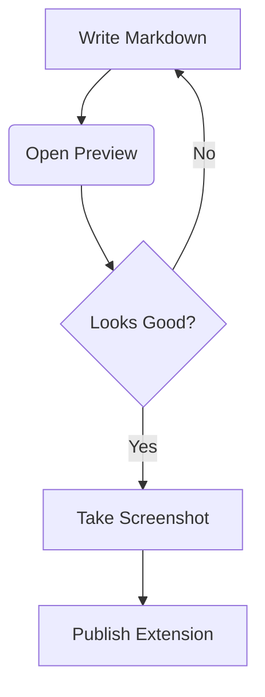

# Advanced MD Preview

Welcome to the **MD Preview** extension! This extension provides a sleek, modern, and beautiful markdown viewing experience right inside Visual Studio Code.

## Features Showcase

Here are some of the markdown features supported:

### 1. Code Highlighting

We support full syntax highlighting using _Highlight.js_:

```javascript
function greet(name) {
  console.log(`Hello, ${name}! Welcome to the Advanced UI.`);
}

greet("Developer");
```

### 2. Beautiful Tables

Tables are styled for readability:

| Feature               | Support | Note                     |
| :-------------------- | :-----: | :----------------------- |
| **Markdown**          |   ✅    | Standard CommonMark      |
| **Code Highlighting** |   ✅    | Highlight.js integration |
| **Mermaid Diagrams**  |   ✅    | Works out of the box     |
| **Sanitization**      |   ✅    | Secure via DOMPurify     |

### 3. Blockquotes

> "Simplicity is the ultimate sophistication."
> — _Leonardo da Vinci_

### 4. Mermaid Diagrams

You can even visualize your workflows directly in the preview:



### 5. Checklists

- [x] Create VS Code extension
- [x] Add Advanced styles
- [x] Include syntax highlighting
- [x] Add Mermaid diagram support
- [ ] Publish to Marketplace!

---

_Created with the MD Preview VS Code Extension._
